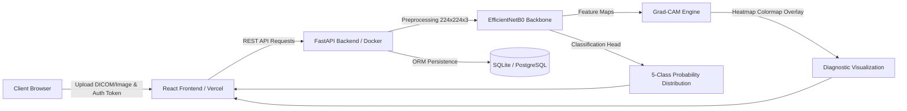

# AI Chest X-Ray Diagnosis System

[](https://react.dev/)
[](https://fastapi.tiangolo.com/)
[](https://www.tensorflow.org/)
[](https://arxiv.org/abs/1905.11946)
[](https://arxiv.org/abs/1610.02391)

An artificial intelligence-driven web platform designed for automated chest radiograph classification and localization using deep convolutional neural networks and explainable artificial intelligence (XAI).

---

## Overview

Chest radiograph evaluation constitutes a critical yet resource-intensive task in clinical radiology. This system provides an automated decision-support pipeline that:

1. Classifies chest X-ray radiographs across five pulmonary disease categories using a balanced EfficientNetB0 backbone.
2. Identifies class-discriminative anatomical regions utilizing Gradient-weighted Class Activation Mapping (Grad-CAM).
3. Generates structured radiology findings with per-user report persistence.
4. Exposes authenticated REST endpoints and a responsive client interface for clinical workflow simulation.

> **Medical Disclaimer:** This software is intended solely for research, academic, and demonstration purposes. It is neither approved for clinical diagnostic workflows nor intended to replace professional radiological evaluation.

---

## System Architecture



---

## Machine Learning Pipeline

### Architecture Specification

The classification pipeline is built upon an EfficientNetB0 architecture tailored for 5-class pulmonary condition detection:

* **Base Model:** `EfficientNetB0` (`include_top=False`, `input_shape=(224, 224, 3)`)
* **Feature Extraction:** `GlobalAveragePooling2D`
* **Regularization:** `BatchNormalization`
* **Representation Layer:** `Dense(256, activation='relu')`
* **Dropout Layer:** `Dropout(0.5)`
* **Output Layer:** `Dense(5, activation='sigmoid')`

### Target Classes

| Class Index | Pathology | Clinical Indication |
|:---:|:---|:---|
| 0 | Infiltration | Pulmonary airspace opacity or consolidation |
| 1 | Effusion | Pathological fluid collection in pleural space |
| 2 | Atelectasis | Partial or complete alveolar collapse |
| 3 | Nodule | Discrete pulmonary lesion (diameter $\le$ 30 mm) |
| 4 | Mass | Discrete pulmonary lesion (diameter > 30 mm) |

### Image Preprocessing Protocol

1. **Greyscale Conversion:** Standardizes single-channel radiograph data.
2. **Bicubic Resampling:** Resizes input image to standard spatial dimensions of $224 \times 224$ pixels.
3. **Channel Duplication:** Replicates single channel across 3 dimensions to maintain compatibility with 3-channel convolutional kernels.
4. **EfficientNet Normalization:** Scales RGB values according to EfficientNet inference standards.
5. **Batch Expansion:** Expands tensor dimensions to shape `(1, 224, 224, 3)`.

### Explainable AI (Grad-CAM)

To provide interpretability for the predictions, Gradient-weighted Class Activation Mapping (Grad-CAM) is computed directly from the final convolutional stage:

* **Target Activation Layer:** `top_conv` (final convolutional stage before pooling, feature dimensions $7 \times 7$)
* **Gradient Extraction:** Utilizes `tf.GradientTape` to compute the gradients of the selected class score with respect to feature maps $A^k$.
* **Neuron Importance Weights:**
  $$\alpha_k^c = \frac{1}{Z} \sum_{i} \sum_{j} \frac{\partial y^c}{\partial A_{i,j}^k}$$
* **Activation Map Generation:**
  $$L_{\text{Grad-CAM}}^c = \text{ReLU}\left(\sum_k \alpha_k^c A^k\right)$$
* **Visualization:** The computed heatmap is normalized, bilinearly interpolated to the original image dimensions, colored with the JET colormap, and blended with 45% alpha opacity over the source radiograph.

---

## Repository Structure

```
xray-app/
├── backend/
│   ├── main.py                     # FastAPI application routes, auth, inference & reports
│   ├── requirements.txt            # Python dependencies with pinned constraints
│   ├── Dockerfile                  # Containerization image for cloud/Render deployment
│   ├── model/
│   │   ├── model_5class_balanced_weights.h5  # Pre-trained balanced network weights
│   │   ├── inference_5class.py     # Standalone model loading and inference logic
│   │   └── model_5class.py         # Network architecture definition
│   ├── uploads/
│   │   └── heatmaps/               # Generated Grad-CAM visual artifacts
│   └── xray_app.db                 # Relational database (SQLite)
│
├── frontend/
│   ├── src/
│   │   ├── components/             # Reusable UI components (Navbar, Modal, ResultCard)
│   │   ├── pages/                  # Application views (Home, Login, Reports)
│   │   ├── context/                # Authentication context and token providers
│   │   ├── services/api.js         # Centralized Axios client and interceptors
│   │   └── main.jsx                # Application root mount
│   ├── vercel.json                 # Vercel Single Page Application rewrite rules
│   ├── vite.config.js              # Vite bundler configuration
│   ├── tailwind.config.js          # Tailwind CSS styles and palette
│   └── package.json                # Frontend package dependencies and scripts
│
├── vercel.json                     # Root deployment configuration for Vercel
├── .gitignore                      # Git exclusion rules
└── README.md                       # Project documentation
```

---

## Installation and Local Setup

### Prerequisites

* Python 3.9 through 3.11
* Node.js 18.x or higher
* npm 9.x or higher

### Backend Configuration

1. Navigate to the backend directory:
   ```bash
   cd backend
   ```

2. Initialize and activate a virtual environment:
   * **Linux / macOS:**
     ```bash
     python3 -m venv venv
     source venv/bin/activate
     ```
   * **Windows:**
     ```powershell
     python -m venv venv
     .\venv\Scripts\activate
     ```

3. Install required dependencies:
   ```bash
   pip install --upgrade pip
   pip install -r requirements.txt
   ```

4. Launch the application server:
   ```bash
   uvicorn main:app --host 127.0.0.1 --port 8000 --reload
   ```

The API service initializes at `http://127.0.0.1:8000`. Interactive OpenAPI documentation is accessible at `http://127.0.0.1:8000/docs`.

### Frontend Configuration

1. Navigate to the frontend directory:
   ```bash
   cd frontend
   ```

2. Install Node dependencies:
   ```bash
   npm install
   ```

3. Start the development server:
   ```bash
   npm run dev
   ```

The client application will be available at `http://localhost:5173`.

---

## Production Deployment

### Frontend (Vercel)

The frontend is configured for deployment on Vercel:

1. Link the repository via the Vercel dashboard.
2. Configure project settings:
   * **Framework Preset:** `Vite`
   * **Root Directory:** `frontend`
   * **Build Command:** `npm run build`
   * **Output Directory:** `dist`
3. Configure the following environment variable:
   * `VITE_API_BASE_URL`: The fully qualified domain of the deployed backend (e.g., `https://api.yourdomain.com`).
4. Trigger the deployment. SPA routing is managed automatically via `frontend/vercel.json`.

### Backend (Docker / Cloud Container Services)

Because the backend executes TensorFlow inference and requires persistent model weight availability, containerized deployment (e.g., Render, Railway, Google Cloud Run) is recommended:

1. Build the Docker container:
   ```bash
   docker build -t xray-backend:latest -f backend/Dockerfile backend/
   ```

2. Run the container locally or in production:
   ```bash
   docker run -d -p 8000:8000 --name xray-backend xray-backend:latest
   ```

3. Set the following environment variables on the hosting provider:
   * `ALLOWED_ORIGINS`: Comma-separated list of permitted frontend origins (e.g., `https://your-app.vercel.app`).
   * `SECRET_KEY`: A cryptographically secure random string for JWT signature validation.
   * `PORT`: Standard port assignment provided by the hosting environment (defaults to `8000`).

---

## API Reference

| HTTP Method | Route | Authentication | Payload / Parameters | Description |
|:---|:---|:---:|:---|:---|
| `GET` | `/health` | None | None | Service liveness probe |
| `POST` | `/auth/register` | None | `{"email": "...", "password": "..."}` | User account registration |
| `POST` | `/auth/login` | None | `OAuth2PasswordRequestForm` | Authenticates credentials and returns JWT bearer token |
| `POST` | `/predict` | Bearer Token | `multipart/form-data` (file: Image) | Performs 5-class classification and generates Grad-CAM heatmap |
| `GET` | `/reports` | Bearer Token | None | Retrieves historical reports associated with the authenticated user |
| `GET` | `/reports/{id}` | Bearer Token | `id: integer` | Retrieves full report record by primary key |
| `GET` | `/uploads/{filename}` | None | `filename: string` | Serves original radiograph assets |
| `GET` | `/uploads/heatmaps/{filename}` | None | `filename: string` | Serves Grad-CAM output visualizations |

---

## License

This project is distributed under the terms of the MIT License.
